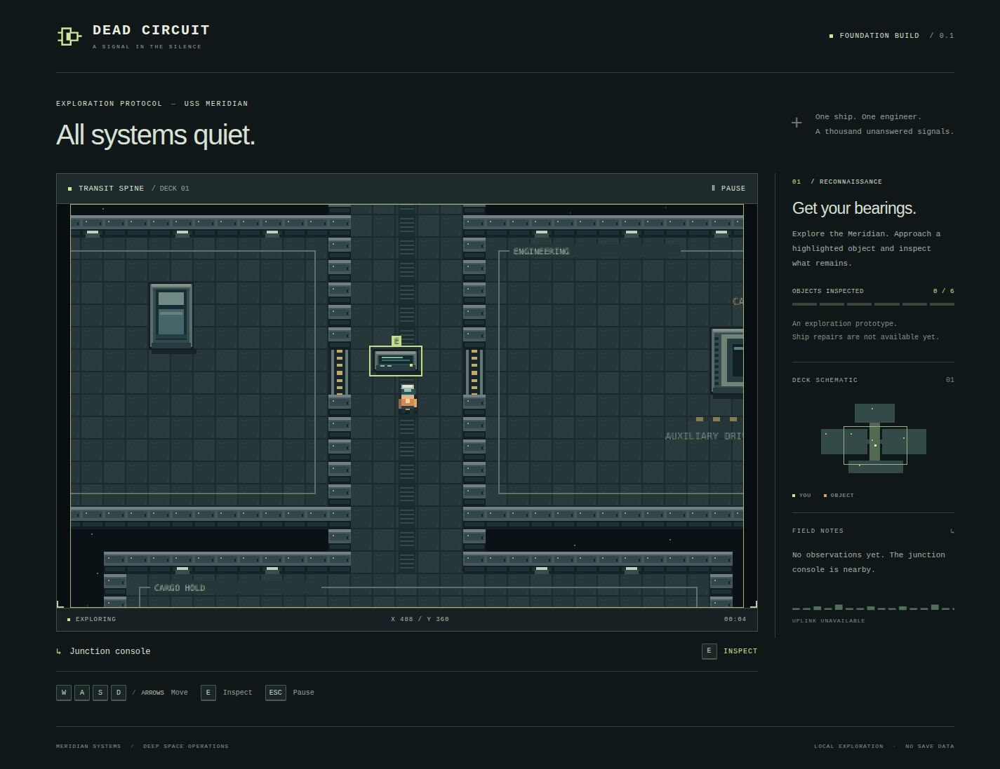

# Foundation verification — 2026-10-14

## Environment

- Existing workspace: `/home/bhuvaneshnallapati/fallship`.
- Node 24.21.0; npm 11.19.0; Vite 8.3.4; Playwright 1.64.1.
- Automated browser: Chromium 156.0.8078.4, headless, desktop 1440×1080 and narrow 360×740.
- Additional visual inspection: Codex in-app browser, same local development server; desktop sidebar and narrow layout checked.
- The user approved attached-terminal commands in this project because VS Code integrated-terminal automation was unavailable. Project files and browser binaries stayed within the supplied directory.

## Recorded results

| Check | Result | Evidence / limit |
| --- | --- | --- |
| JavaScript syntax | Passed | `node scripts/check.mjs` checked source, scripts and tests |
| Unit tests | 17 passed | `npm test`; no failures/skips |
| Production build | Passed | `npm run build`; generated `dist/` |
| Browser regressions | 5 passed | `npm run test:browser`; final run completed in 10.5 seconds |
| Browser console/network | Passed for exercised flows | No page exceptions, console errors or HTTP responses ≥400 in browser suite |
| Desktop visual check | Passed | Pixel art, HUD, map, room labels, menus and inspection panel inspected |
| Narrow layout | Passed | No horizontal overflow at 360 px; dialog/start button and scaled canvas fit |

## Behavior exercised

The unit suite covers malformed maps; unobstructed spawn/object bounds; connected floors; routes to all seven interactions with player bounds and solid objects; normalized movement; wall/world/object collision; wall sliding; high-displacement tunneling; interaction range and wall occlusion; camera edges/small worlds; timing at 30/60/144 Hz; delayed-frame limits; reset during an update; inactive-state freezing; key aliases/opposites; repeated action keys; inspection state; and corner/ejection easter eggs.

The production-browser suite uses real keyboard/button input to start, hit the east corridor wall, walk through a threshold into Engineering, confirm that the player's rendered pixels remain centered as the camera follows, inspect the junction console, reject repeated interaction keydown, freeze movement in inspection/pause, resume, reset to title, and start a clean session. It also checks rendering dimensions, disabled smoothing, multiple canvas colors, menu focus, viewport fit, and the keyboard-only notice.

Focus-loss handling is exercised by dispatching the browser `blur` event while a movement key is held. This verifies the listener and state transition; it is not a cross-platform operating-system focus test. Hidden-page handling shares the same cleanup path but was not separately automated. The entire ship's interaction reachability is tested by simulation, while the automated browser movement route covers the spine and engineering doorway.

## Review findings resolved

1. A clock reset from inside the update callback was followed by a timestep subtraction, making the new accumulator negative. Moved subtraction before the callback; added a regression test.
2. The wordmark accessible label suggested a title action while it paused. Made the wordmark noninteractive; title navigation remains explicit in the pause menu.
3. Tile-only connectivity could miss blocked routes caused by props. Added a collision-aware route/interaction regression for every placeholder.
4. Adjusted medium-width padding to allow a full 2× canvas when 960 display pixels fit.
5. Development browser logs exposed `ResizeObserver loop completed with undelivered notifications` during viewport changes. Queued canvas dimension writes for the next animation frame, ignored height-only observations, and cancelled pending resize work on disposal. Expanded the browser test to resize repeatedly across four widths.

## Visual evidence

[Inspection dialog capture](screenshots/inspection-desktop.jpg) · [Narrow layout capture](screenshots/foundation-narrow.jpg)

Screenshots show the development build of the same foundation source. Automated functional checks run against the production bundle, using a separate test-owned preview server.

Final command pass: `node scripts/check.mjs && npm test && npm run test:browser`. All checks passed after the last source edit. Temporary preview processes were stopped after QA; use `npm run dev` to resume local play.

## Limits and next gate

No known functional blocker was found in the tested flows. Firefox, Safari, touch/gamepad controls, full screen-reader gameplay, audio, save data, programming, virtual CPU, campaign, and repairs are not verified or implemented as applicable. No deployment was performed.

Next: user playtest of the foundation, then agree the smallest programming-interaction specification before starting the next milestone. Keep the remaining 100-hour allocation provisional and preserve testing time.
